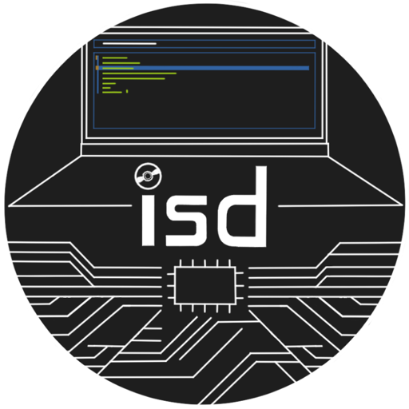

# isd – *i*nteractive *s*ystem*d*

    

<!-- --8<-- [start:tagline]  -->
> `isd` – a better way to work with `systemd` units

Simplify `systemd` management with `isd`!
`isd` is a TUI offering fuzzy search for units, auto-refreshing previews,
smart `sudo` handling, and a fully customizable interface
for power-users and newcomers alike.
<!-- --8<-- [end:tagline] -->

<!-- --8<-- [start:features] -->
`isd` is a keyboard-focused, highly customizable TUI with the following features:

- Quickly switch between `system` and `user` units
- Fuzzy search units
- Auto refresh previews
- Quickly open outputs in a pager or editor
- Auto `sudo` prefixing if required
- Auto rescale depending on terminal window size (fluid design)
- Extensive command palette with many keyboard shortcuts
- Fully configurable keybindings
- Optional input state caching for common inputs
- Theme support
- YAML configuration file _with auto-complete_
<!-- --8<-- [end:features] -->

## Demo

https://github.com/user-attachments/assets/a22868c0-fc01-4973-86ea-410b80b188a8

[Click here for a higher quality recording](https://kainctl.github.io/isd/#working-with-isd).

## Documentation

The documentation is live at:

- <https://kainctl.github.io/isd/>

## Installation

The tool can be installed via `uv`, `nix`, and as an `AppImage`.
Refer to the [official installation documentation](https://kainctl.github.io/isd/#installation) for more details.

## Acknowledgments

<!-- --8<-- [start:acknowledgments] -->
Big thanks to the developers of:

- [systemd](https://systemd.io/) for creating the most widely used service manager for Linux
- [NixOS](https://nixos.org/) for piquing my interest in `systemd` and service managers
- [`sysz`](https://github.com/joehillen/sysz) for providing a starting point and a desire to build a more complex `systemctl` TUI
- [textual](https://textual.textualize.io/) for making it a breeze to create TUIs in Python
- [Zensical](https://zensical.org/) for building a solid and simple to use static site generator for the documentation
- [asciinema](https://docs.asciinema.org/) for developing an easy to use _and self-hostable_ terminal recorder and player
- [vhs](https://github.com/charmbracelet/vhs) for creating a scriptable terminal program
- [posting](https://github.com/darrenburns/posting) for showing me how to use `textual`
<!-- --8<-- [end:acknowledgments] -->

## Star history ⭐

